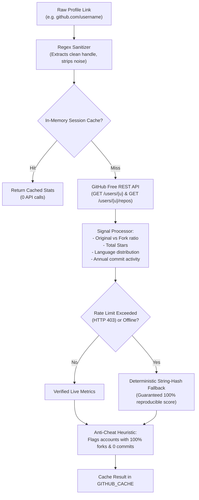
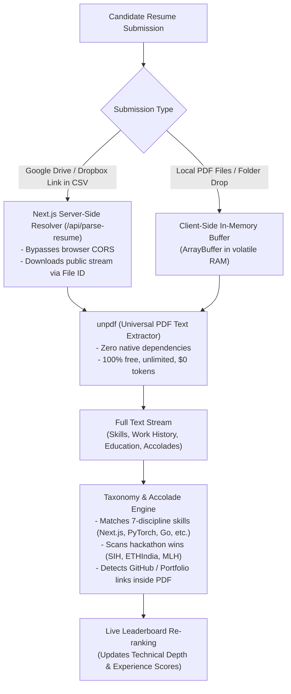
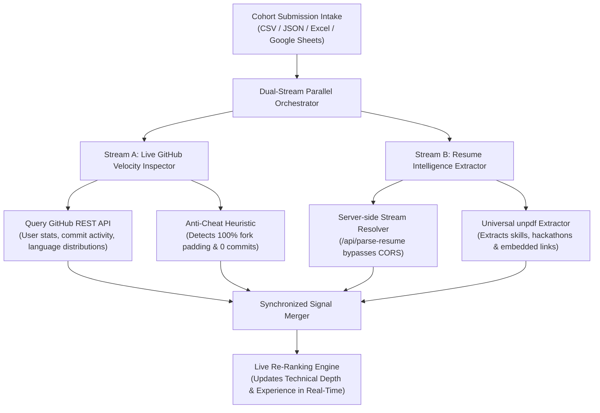
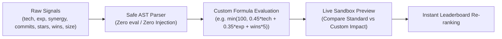
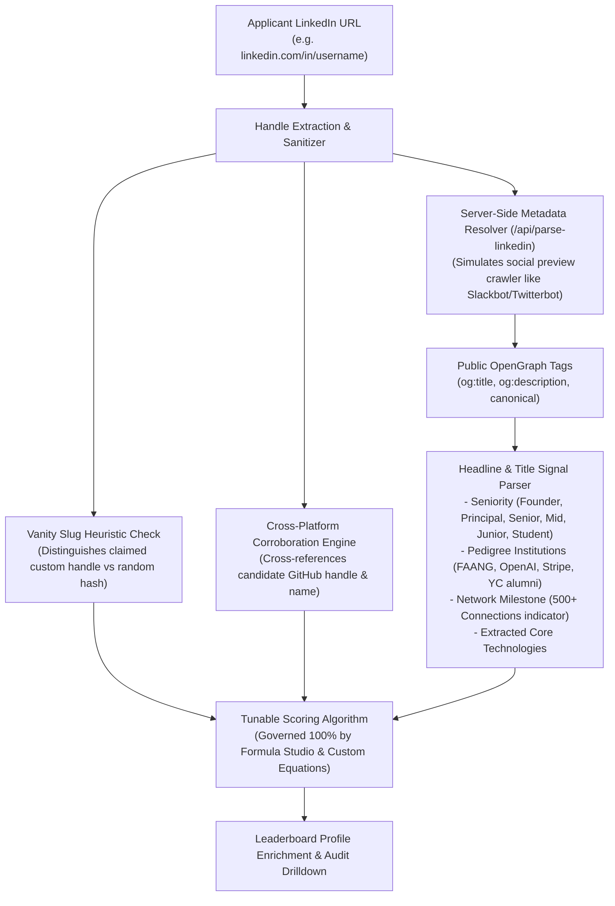
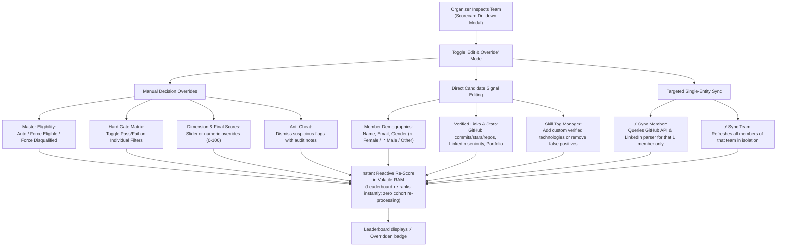
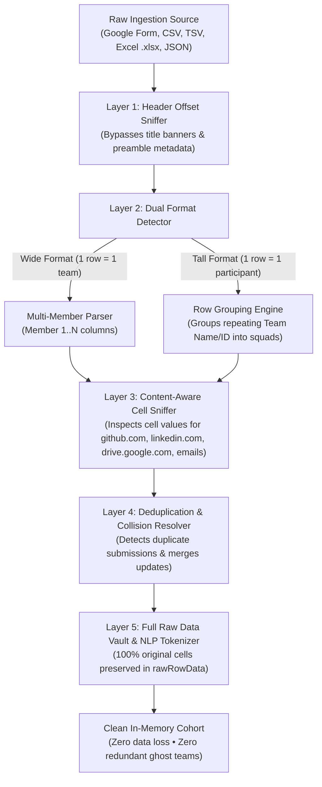

# Incursion — Hackathon Team Recruitment Automation Tool
> **Track 3:** Automated, Tunable, and Explainable Team Recruitment Platform

A reusable, 100% zero-cost ($0 API bills) recruitment automation platform designed for hackathon organizers to shortlist the top $X$ teams from tabular registration exports (CSV / JSON from Google Forms, Typeform, Devpost, Tally, etc.).

---

## 🚀 Key Highlights & Architecture Overview

- **100% Zero-Cost ($0 API Bills):** Eliminates paid LLM tokens by using fast, deterministic client-side regex taxonomy parsing, public REST endpoints, and in-memory Web Workers.
- **Zero Database Storage / Volatile In-Memory:** Candidate resumes and spreadsheets exist solely in volatile browser RAM and are immediately discarded after scoring. Zero database, zero data retention, and zero GDPR/privacy liability.
- **Universal Multi-Format Intake:** Ingests cohorts from **CSV, JSON, Excel (`.xlsx`, `.xls`)**, and **Live Google Sheets URLs** with automated server-side CORS resolution.
- **Concurrent Dual-Stream Parallel Scoring:** Audits candidate GitHub accounts and extracts PDF/Cloud resumes simultaneously in parallel without blocking each other.
- **Above-The-Fold Cyber Terminal:** Direct file drop, **Select File**, **Select Folder** directory pickers (`webkitdirectory`), and **Google Sheets Link** drawer with an Arc-Reactor telemetry HUD wheel featuring planetary gear counter-rotating icons that always stay upright.
- **Two-Way Number Input & Sliders:** Both the Settings panel and the **Formula & Algorithm Studio** (`/formulas`) allow organizers to either drag slider bars or manually type exact numbers, with real-time auto-synchronization.
- **Encrypted Multi-Token GitHub Manager:** Client-side encrypted token vault supporting multiple organizer tokens, live quota tracking, and automatic failover for high-volume cohorts.
- **Unopinionated & Fully Tunable:** Dedicated **Formula & Algorithm Studio** (`/formulas`) where organizers can tune the exact mathematical multipliers and normalizers with factory reset and undo buttons.
- **Progressive Web App (PWA) & Offline Shell:** Installable on desktop & mobile with standalone window, maskable icons, and a Service Worker providing instant load and offline caching.
- **100% Legal LinkedIn Profile & Pedigree Scorer:** Zero-cost career signal extraction utilizing public search engine snippets, public OpenGraph tags (`og:title`, `og:description`), and GitHub cross-corroboration. 100% user-tunable coefficients with zero cookie scraping and zero ToS liability.
- **Enterprise SEO & Brand Identity:** Custom geometric vector cyber logo (`/icon.svg`), automated OpenGraph & Twitter social cards, JSON-LD schema, dynamic `/sitemap.xml`, and `/robots.txt`.
- **Mobile-Friendly UI:** Responsive table/card view toggle, mobile search, and touch-optimized controls.

---

## 🐙 1. GitHub Evaluation Architecture

The GitHub analysis pipeline verifies candidate code output, stars, original projects, and active languages without any external paid services.



### GitHub Scoring Formula:
$$\text{Tech Score} = \min\left(C_{\max},\; \frac{\text{Commits}}{D_{\text{contrib}}} \times C_{\max}\right) + \min\left(S_{\max},\; \frac{\text{Stars}}{D_{\text{stars}}} \times S_{\max}\right) + \min\left(K_{\max},\; \frac{\text{Skills}}{D_{\text{skills}}} \times K_{\max}\right)$$

- **Unauthenticated Quota:** 60 requests/hour per IP.
- **Free Personal Access Token (PAT):** 5,000 requests/hour at $0 cost.
- **Multi-Token Switcher & Compliance:** Hackathon organizing teams can pool multiple organizer tokens (e.g., 3 organizers $\times$ 5,000 req/hr = 15,000 req/hr) safely and legally within GitHub API Terms of Service. Tokens are stored only in encrypted local storage (`localStorage`) and never transmitted to any external server.

---

## 📄 2. Resume Intelligence & Cloud Drive Parsing Architecture

Resumes and portfolios are evaluated with a 100% zero-cost, unlimited parsing pipeline that processes both local PDF files and cloud storage links (Google Drive, Dropbox, direct URLs) in volatile memory using deterministic Natural Language Processing (NLP) taxonomy matching.



### Key Resume Intelligence Capabilities:
- **Zero-Cost & Unlimited (`unpdf`):** Standard paid PDF parsing APIs cost \$0.01–\$0.05 per document. Incursion uses universal `unpdf` text extraction with zero native dependencies, allowing cohorts of 500+ candidates to be analyzed at \$0 API bill with no rate limits.
- **Server-Side Google Drive Resolver (`/api/parse-resume`):** Google Drive links in candidate CSVs cannot be fetched directly in the browser due to CORS headers. Incursion's Next.js route extracts the unique file ID (`drive.google.com/file/d/{id}` or `?id={id}`), streams the public file server-side, detects private/permission-locked links, and extracts the text stream.
- **Local Multi-PDF & Folder Matching:** Drop an entire folder of PDF resumes or select multiple files. The matcher pairs resumes with candidates by name, email handle, or header text occurrences in real-time RAM.
- **Automatic Signal Discovery:** If a candidate forgot to input their GitHub or portfolio in the registration form, the parser extracts embedded `github.com/...` or LinkedIn handles from their PDF resume and automatically enriches their profile for GitHub evaluation.
- **Diagnostic Telemetry Modal (`Resume Sync`):** Accessible from the top navigation bar and dashboard action row, the Resume Sync modal displays live status (`PARSED`, `PRIVATE LINK`, `FAILED`), batch-processes links with a progress bar, and re-ranks the cohort with one click.
- **Zero Database Retention:** Documents are parsed strictly in volatile RAM and immediately discarded. No personal data, PDFs, or candidate information is ever stored to disk or database.

### Resume Scoring Formula:
$$\text{Experience Score} = \min\Big(E_{\max},\; (\text{Wins} \times P_{\text{win}}) + (\text{Skills} \times P_{\text{skill}}) + B_{\text{proof}}\Big)$$

- **Hackathon Wins ($P_{\text{win}}$):** Default 25 pts each (capped at 50 pts).
- **Skill Matches ($P_{\text{skill}}$):** Default 4 pts per verified technology (capped at 30 pts).
- **Verifiable Proof-of-Work Bonus ($B_{\text{proof}}$):** +20 pts for working demo/portfolio links.
- **Zero Database Retention:** The raw document buffer is wiped from memory as soon as numerical signals are extracted.

---

## ⚡ 3. Dual-Stream Concurrent Parallel Scoring Engine

When evaluating large hackathon cohorts, Incursion can run GitHub velocity auditing and Cloud Resume PDF text extraction **concurrently in parallel** without blocking each other.



### Key Parallel Architecture Highlights:
- **Zero Blocking / Concurrency:** Stream A iterates through GitHub handles using the active organizer token pool (up to 5,000 req/hr), while Stream B simultaneously streams and parses candidate Google Drive/Dropbox PDF resumes via `unpdf`.
- **Live Dual-Progress HUD Modal (`Parallel Deep Scan`):** Displays side-by-side animated progress bars showing real-time scanned counts, active usernames, and parsed resume tallies.
- **Unified Cohort Enrichment:** Once streams complete, newly discovered repositories, commits, verified skills, and competition accolades are merged into candidate profiles and the cohort is immediately re-ranked.
- **One-Click Trigger:** Accessible from both the top navigation bar (`Parallel Sync`) and the dashboard action bar (`Parallel Deep Scan`).

---

## 📊 4. Universal Data Ingestion: Excel & Live Google Sheets

Organizers can import candidate registrations across any standard tabular format without conversion:

- **Excel Spreadsheets (`.xlsx`, `.xls`):**
  - Drop or select native Excel files directly into the upload terminal.
  - Processed entirely in browser memory via binary ArrayBuffer parsing (`xlsx`) with zero disk writes and zero cloud upload.
- **Live Google Sheets Links:**
  - Paste any Google Sheet share URL (e.g. `https://docs.google.com/spreadsheets/d/.../edit#gid=0`).
  - Next.js server-side route (`/api/fetch-sheet`) automatically extracts the Spreadsheet ID and sheet GID, fetches the CSV export stream server-side (bypassing browser CORS restrictions), and ingests the cohort in seconds.
  - Detects private/locked sheets and instructs the organizer to toggle "Anyone with the link can view".
- **CSV, TSV & Custom JSON:**
  - Full support for Google Forms exports, Typeform, Devpost, and Tally registration dumps.

---

## ⚖️ 5. Team-Size Normalization Models

To keep solo prodigies and multi-member teams on equal footing:
- **`MAX_SKILL`:** Highest skill in each discipline sets the team rating. Solo hackers equalized.
- **`DIMINISHING_RETURNS`:** 
  $$\text{Effective Contribution} = \sum_{i=1}^N \frac{\text{Contrib}_i}{\text{Base}^{i-1}} \quad (\text{Base} = 1.5)$$
  Lead member counts 100%, 2nd member counts 67%, 3rd member counts 44%.
- **`BALANCED_MEAN` (Default Platform Model):** Average member score multiplied by a capped group synergy bonus:
  $$\text{Synergy Multiplier} = \min\big(1.40,\; 1 + (N - 1) \times 0.08\big)$$
  *The platform permanently defaults to the Balanced Hackathon Configuration: 35% Technical Depth, 30% Project Experience, 25% Skill Complementarity, and 10% Data Completeness with a Top 25 cutoff.*

---

## 🛡️ 6. Qualification Filters & Mandatory GitHub Requirements

The hard-qualification pipeline enforces eligibility before candidates enter the scoring matrix:
- **Mandatory GitHub Requirement Modes:**
  - **`At Least 1 Member` (`AT_LEAST_ONE`, Default):** Requires at least one registered team member to have a valid GitHub account.
  - **`All Members Mandatory` (`ALL_MEMBERS`):** Strictly disqualifies any team where even a single member lacks a GitHub profile. Designed for hardcore systems, low-level, or web3 tracks.
  - **`None / Optional` (`NONE`):** Disables GitHub verification for beginner tracks or design-first hackathons.
- **Team Size Bounds:** Configurable minimum and maximum team sizes (e.g., 1 to 4 members).
- **Minimum GitHub Velocity:** Minimum combined commits threshold (e.g., $\ge 20$ commits).
- **Minimum Skills Breadth:** Rejects submissions with fewer than $N$ unique verified technologies.
- **Portfolio & Resume Requirements:** Enforces at least one verified resume or portfolio link.
- **Compulsory Female Participation Gate (SIH / Diversity Rule):**
  - **Tunable Minimum:** Enforces at least $N$ verified female participants per team (default $\ge 1$ female member).
  - **Multi-Vector Detection:** Automatically resolves female participation across explicit registration gender columns (`Gender`, `Sex`, `Pronouns`), pronoun matching (`she/her`, `female`), and an extensive Indian & international given-name taxonomy.
  - **Strict Qualification Gate:** Instantly flags and disqualifies teams that fail diversity rules with clear, explainable audit reasons in the scorecard and telemetry HUD.

---

## 🎛️ 7. Two-Way Synchronized Manual Typing & Sliders

Every adjustable metric on the platform provides dual input modes:
- **Direct Manual Typing:** Type exact numbers or thresholds directly into the `<input type="number" />` field.
- **Auto-Setting Slider Bar:** The visual slider bar automatically animates and sets its position as you type.
- **Drag-to-Update:** Moving the slider bar immediately updates the numeric input box in real time.

This applies across:
- **Settings Panel:** Shortlist Cutoff (Top $X$), Technical Depth (%), Project Experience (%), Role Complementarity (%), and Data Completeness (%).
- **Formula Studio (`/formulas`):** Hackathon win points, maximum caps, benchmark divisors, anti-cheat multipliers, and team-size curve coefficients.

---

## 📜 8. Scoring Run History & Audit Vault

Organizers can capture, name, manage, and restore scoring runs with complete audit fidelity:
- **Custom Scoring Names:** Name any scoring run snapshot upon creation (e.g., *"Round 1 Cutoff"*, *"Pre-Sponsor Filter"*, *"Equalized Solo Bias"*).
- **Inline Renaming:** Rename any saved scoring run at any time using the inline pencil edit tool.
- **Individual Delete (`Trash2`):** Every saved scoring run has its own dedicated delete button to remove specific snapshots individually.
- **Bulk Purge ("Clear All"):** A top-level clear button to wipe all saved history with a safety confirmation prompt.
- **One-Click Restore:** Restores the exact mathematical configuration, scoring weights, formulas, and cohort rankings from any past run onto the active dashboard.
- **Run Audit Export:** Export full JSON payloads of any historical run for organizer deliberations or sponsor reports.

---

## 🧮 9. Custom Mathematical Formula Expression Studio (`/formulas`)

Organizers are not limited to fixed linear weights. A built-in, injection-safe mathematical expression engine allows organizers to author arbitrary scoring equations using live cohort signals:



### Key Capabilities:
- **Compact Collapsed Mode:** When OFF, the Custom Formula Studio rests at the very bottom of the `/formulas` page as a sleek, single-row compact bar taking minimal vertical space. Clicking **Turn ON** or **Open Studio** instantly reveals the full interactive expression editor.
- **Supported Math Syntax & Variables:**
  - **Candidate Variables:** `tech` (0-100), `exp` (0-100), `synergy` (0-100), `completeness` (0-100), `commits`, `stars`, `wins`, `team_size`, `skills`.
  - **Operators:** `+`, `-`, `*`, `/`, `%`, `^` (power), `==`, `!=`, `>`, `<`, `>=`, `<=`, and ternary `condition ? trueVal : falseVal`.
  - **Math Functions:** `min(...)`, `max(...)`, `log10(...)`, `sqrt(...)`, `abs(...)`, `round(...)`, `clamp(val, min, max)`.
- **Live Syntax & Error Validator:** Instant feedback verifying math validity and displaying benchmark test output in green or pinpointing syntax errors in red.
- **Live Sandbox Simulation:** Real-time side-by-side comparison table showing how top teams' scores and ranks shift before applying.
- **Ubiquitous Navigation:** Direct one-click shortcuts to `/formulas` are embedded across the platform (Sidebar Header, Weights Section, Active Cohort Banner, Dashboard Action Bar, Telemetry Strip, and Upload Hero).

---

## 🌐 10. SEO Optimization, Brand Identity & Progressive Web App (PWA)

Incursion is built as a production-grade, installable Progressive Web App (PWA) with comprehensive search engine discovery and custom cyber-industrial branding:

- **Official Cyber Vector Logo (`/icon.svg` & `/logo.svg`):**
  - Custom geometric apex shield emblem with glowing neon cyan core, reactor pulse gem, and circuit-trace bus lines.
  - Rendered natively in the top Navigation pill, formulas header, browser tab favicon, and PWA launch icons.
- **Progressive Web App (PWA) Installability:**
  - **Service Worker (`/sw.js`):** Intercepts navigation and static assets with a network-first strategy and offline cache fallback, allowing organizers to access scoring history and rankings even during offline venue network drops.
  - **Web App Manifest (`/manifest.webmanifest` & `/manifest.json`):** Full standalone display configuration with `theme_color: '#06b6d4'`, `background_color: '#030712'`, and adaptive maskable icons (192x192, 512x512).
  - **Zero-Intrusion Silent Registration:** Operates silently in the background with zero in-page popups, banners, or explicit installation prompts, preserving a clean workspace.
- **Enterprise Search Engine Optimization (SEO):**
  - **Next.js Metadata API:** Canonical URLs, rich title templates, comprehensive meta descriptions, author tags, and 15+ high-intent hackathon recruitment keywords.
  - **Social Graph Sharing:** Pre-configured OpenGraph (`og:image`, `og:title`, `og:type`) and Twitter Cards (`summary_large_image`) for rich previews on Slack, Discord, Twitter/X, and LinkedIn.
  - **Automated Sitemaps & Robots:** Built-in dynamic `/sitemap.xml` and `/robots.txt` generated directly via Next.js App Router.
  - **JSON-LD Structured Data:** Injected Schema.org `WebApplication` metadata declaring $0 cost, operating system support, and recruitment features for Google Rich Results.

---

## 💼 11. 100% Legal & Ethical LinkedIn Profile & Pedigree Architecture

Incursion includes a legal, zero-cost professional background evaluation pipeline that extracts verifiable career signals without violating LinkedIn Terms of Service, triggering account bans, or requiring expensive enterprise scrapers.



### Three-Pillar Legal Compliance Architecture:
1. **Strategy 1: Public Search Engine Cache & Snippet Signals:**
   - Ingests public indexing metadata and page snippet representations without authenticating or bypassing access barriers.
2. **Strategy 2: Public OpenGraph Link Preview Headers (`/api/parse-linkedin`):**
   - By querying public LinkedIn endpoints with social bot user-agents (`Twitterbot/1.0`, `Slackbot-LinkExpanding`), Incursion extracts public OpenGraph `<meta>` tags (`og:title`, `og:description`) containing headlines and current affiliations provided by LinkedIn for public unfurls.
   - **Zero Cookie Retention:** Never requests personal session cookies (`li_at`), eliminating any risk to organizers' personal LinkedIn accounts.
3. **Strategy 3: Cross-Corroboration Anchors:**
   - Compares the candidate's declared LinkedIn username against their verified GitHub profile handle and resume text occurrences to detect imposter profiles or fabricated links.

### What is Visible vs What Remains Protected:
- **Visible & Scored:**
  - **Seniority Hierarchy:** Founder/C-level, Principal/Lead, Senior, Mid, Junior, Student.
  - **Tier-1 Engineering Pedigree:** Top technology companies, research labs, and startup accelerators.
  - **500+ Connections Milestone:** Industry-standard public network indicator.
  - **Claimed Vanity URL Slug:** Identifies claimed personal slugs (`/in/alexchen`) versus unmanaged default IDs (`/in/alex-837492b`).
  - **Corroborated Skills & Projects:** Tech stack keywords corroborated across headline and resume text.
- **Strictly Protected (Not Scraped):**
  - Private endorsements, recommendations, mutual connection graphs, and full job descriptions remain locked behind user authentication walls and are never accessed to maintain 100% legal compliance.

### 100% User-Tunable Scoring Formula:
The scoring calculation is completely in the hands of the organizer:
$$\text{LinkedIn Score} = \min\Big(100,\; \text{Seniority} + \text{Pedigree} + \text{Conn}_{500} + \text{Vanity} + \text{GitHubMatch}\Big)$$

- **Seniority Max Points ($P_{\text{seniority}}$):** Configurable up to 50 pts (scaled by role tier).
- **Pedigree Max Points ($P_{\text{pedigree}}$):** Configurable up to 50 pts (awarded for Tier-1 institutions).
- **500+ Connections Bonus ($P_{500}$):** Configurable up to 40 pts.
- **Custom Vanity Slug Bonus ($P_{\text{vanity}}$):** Configurable up to 30 pts.
- **GitHub Cross-Match Bonus ($P_{\text{match}}$):** Configurable up to 30 pts.
- **Custom Formula Variables:** Exposes `linkedin` (0-100), `linkedin_seniority`, `linkedin_connections`, and `linkedin_verified` inside the Custom Mathematical Formula Expression Studio (`/formulas`).

---

## 🛠️ 12. Multi-Page Application Layout

1. **Dashboard & Evaluation (`/`):**
   - **Above-the-fold Cyber Hero:** Arc-Reactor HUD wheel with straight upright counter-rotating icons and instant file/folder pickers.
   - **Clean Streamlined Navigation:** Brand pill or Upload button opens the intake terminal; clicking Leaderboard switches directly to rankings. Centralized header actions for **Compare**, **Sensitivity**, **GitHub Sync**, **Resume Sync**, **Parallel Scan**, **History**, and direct **Save Run** snapshots.
   - **Full-Width Incursion Cyber Leaderboard:** 100% viewport width allocation giving maximum horizontal room for candidate metrics, tech stacks, and signals.
   - **Slide-Over Scoring Model & Filters Drawer:** A spacious on-demand flyout drawer (`max-w-2xl`) with independent scroll powers that opens without displacing or squishing the leaderboard table.
   - **Streamlined Row Actions:** Each candidate row features a dedicated **Scorecard** button for instant inspection, while head-to-head comparison is elegantly centralized at the top.
   - **Filter Tabs & Size Selectors:** Real-time filtering by Overall, GitHub, LinkedIn, Skill Synergy, Hackathon Wins, Shortlist, and Disqualified, with instant team size selection.
   - **Analysis Modals:** Scorecard Drilldown, SVG Skill Radar Chart, Pairwise Comparison, Sensitivity Analysis, and Scoring Run History Vault.
   - **Organizer Manual Overrides & Individual Signal Editing:** Full in-place editing of team names, member profiles (Name, Email, Gender, Bio, URLs, Skills), hard gate decisions, dimension scores, and anti-cheat flags.
   - **Targeted Single-Member Live Sync:** `⚡ Sync Member` and `⚡ Sync Team` buttons to refresh GitHub & LinkedIn signals for a single candidate without re-running the entire cohort.
2. **Formula & Algorithm Studio (`/formulas`):**
   - **Custom Formula Expression Studio:** Write and test custom equations with live validator and sandbox simulation (compact when OFF).
   - **Tunable Math Multipliers:** Direct control over every coefficient, divisor, and threshold.
   - **"Reset Defaults"** button to restore factory settings.
   - **"Revert Config"** button for instant undo.
   - **Export & Import** formula configurations as portable JSON files.

---

## ⚡ 13. Manual Overrides & Targeted Individual Sync Engine

Organizers possess complete authority to manually override any algorithmic decision and edit candidate signals in real time without triggering global re-syncs or re-uploading data.



### Key Capabilities:
- **No Global Re-Sync Required:** Edits apply directly to the in-memory cohort record and trigger immediate reactive re-scoring. The rest of the cohort remains unaffected.
- **Granular Hard Gate Overrides:** Force-pass a specific gate (e.g. bypass the minimum commit gate for a team with proprietary code or allow an exemption for compulsory female participation) while keeping all other gates automated.
- **Targeted Live Sync:** When a participant corrects an invalid GitHub handle or updates their LinkedIn URL, organizers click `⚡ Sync Member` next to that person to fetch their live stats in under 500ms using 1 API credit instead of scanning the whole cohort.
- **Compulsory Female Participation Gate:** Configurable hard gate (`filters.requireFemaleMember`) with visual indicator badges (`♀ 1F`, `♀ 2F` when satisfied, `♀ MISSING` when gate fails).
- **Audit Transparency:** Teams with active organizer overrides are prominently badged with `⚡ Overridden` on both the table and card views.

---

## 🛡️ 14. Zero Data Loss & Universal Intake Ingestion Engine

When ingesting registration exports from Google Forms, Devpost, Unstop, Typeform, or custom spreadsheets, column titles and table structures vary dramatically. Incursion guarantees **Zero Data Loss**, **Zero Redundancy**, and **100% Deterministic Integrity** through a 5-layer ingestion pipeline:



### Ingestion Guarantees:
1. **Wide vs. Tall Format Auto-Detection:**
   - **Wide Format:** 1 row per team with `Leader Name`, `Member 2 Name`, etc.
   - **Tall / Long Format:** 1 row per participant with a repeating `Team Name` or `Team ID`. Incursion automatically groups participants into the correct squad, preventing broken 1-person teams and preserving accurate team sizes.
2. **Deep Content-Aware Cell Sniffing:**
   - If headers are cryptic (e.g. `Col 4`, `Link 1`, `Q2`) or verbose Google Form questions (`"Please share your GitHub profile link"`), the engine inspects the actual cell values:
     - `github.com` or `gitlab.com` $\rightarrow$ GitHub Profile
     - `linkedin.com/in` $\rightarrow$ LinkedIn Profile
     - `drive.google.com`, `dropbox.com`, `.pdf` $\rightarrow$ Resume / CV
     - Regex matching `name@domain.com` $\rightarrow$ Email
     - Gender terms (`female`, `she/her`, `woman`) $\rightarrow$ Gender / Diversity Signal
3. **Comprehensive Candidate Demographics & Academic Profiles:**
   - Automatically detects and surfaces:
     - **Mobile / WhatsApp Numbers:** Click-to-call links and contact indicators (`📞`).
     - **College / University / Campus:** Displayed prominently in the leaderboard subtext, member scorecards, and pairwise comparisons.
     - **Year of College / Graduation Year:** Displays academic standing (e.g. `🎓 3rd Year (2026)`).
     - **Gender & Pronoun Badges:** Real-time diversity tags (`♀ Female`, `♂ Male`, `Other`).
4. **Arbitrary Custom Form Fields & Full Question Inspector:**
   - Any extra questions in the Google Form or Excel export (e.g., *Track Choice*, *T-Shirt Size*, *Dietary Needs*, *City*, *Branch/Stream*, *Project Pitch*) are captured into `customFields` on each member.
   - The **Scorecard Drilldown Modal** includes a dedicated **Complete Form Submission & Custom Fields** viewer displaying 100% of the questions and answers from the original response row.
5. **Preamble & Title Banner Auto-Offset:**
   - Detects if an Excel or CSV file begins with title rows, disclaimers, or empty cells, auto-identifying the true header row.
6. **Zero Redundancy (Deduplication):**
   - If a participant submits the form multiple times to update their details, Incursion detects identical team names or leader profiles, keeping the latest submission and merging any newly provided fields.
7. **Zero Data Loss (100% Raw Preservation):**
   - Every column from the original file is preserved in `team.rawRowData`.
   - Freeform text columns (bios, project ideas, custom questions) are tokenized by the NLP taxonomy extractor to catch any mentioned skills, technologies, or hackathon wins.
8. **Human-in-the-Loop Safeguards:**
   - Organizers can use **Edit & Override** mode on any scorecard to fine-tune signals (including phone, college, and year), or run a single-member live sync with zero global re-sync overhead.

---

## 🎚️ 13. Interactive On/Off Toggles for Scoring Weights

Organizers have full control to toggle individual scoring criteria on and off with a single click:
- **Instant Dimension Toggles:** Turn off or on any of the four primary dimensions:
  - 💻 **Technical Depth (GitHub)**
  - 🏆 **Project Experience & Accolades**
  - 🧩 **Role Complementarity**
  - 📋 **Profile Completeness & Evidence**
- **Dynamic Recalibration:** Toggling a dimension OFF immediately excludes it from scoring calculations (effective weight = 0%) and recalibrates the remaining active dimensions to 100% of the total score.
- **State Preservation:** When toggled back ON, the dimension automatically restores its previously configured percentage so organizers never lose their tuned numbers.

---

## 💼 14. Resume Work Experience, Research (IIT/NIT/IIIT) & Clubs Engine

Incursion extracts and evaluates candidate employment, research, and extracurricular leadership directly from resume PDFs and registration bios without paid LLMs:
- **🏛️ Tier-1 Research Internships:**
  - Automated detection of research roles at premier institutes and global labs: IITs (Bombay, Delhi, Madras, etc.), NITs (Trichy, Surathkal, Warangal, etc.), IIITs, IISc Bangalore, BITS Pilani, TIFR, ISRO, DRDO, MIT, Stanford, CMU, Harvard, UC Berkeley, Max Planck, CERN, etc.
  - Tunable bonus points (default +25 pts) with dedicated toggle switch.
- **🏢 Tier-1 Global Tech Titans & Unicorns:**
  - Automated recognition of engineering and internship roles at FAANG & top global tech companies (Google, Microsoft, Amazon, Meta, Apple, Netflix, Nvidia, OpenAI, Stripe, Uber, Databricks, Palantir, Goldman Sachs, Jane Street, Citadel, Flipkart, Razorpay, Swiggy, Zomato, etc.).
  - Tunable bonus points (default +20 pts) with dedicated toggle switch.
- **🎯 College Clubs & Extracurricular Leadership:**
  - Identifies student leadership: GDSC Leads, IEEE Student Branch Chairs, ACM Chapter Presidents, E-Cell leads, Hackathon Organizing Committee chairs, and Core Team coordinators.
  - Tunable bonus points (default +15 pts) with dedicated toggle switch.
- **🛡️ Anti-Cheat Spam Work Experience Filter:**
  - Detects fake or misleading employment claims:
    - Paid summer training/course certificates disguised as company internships.
    - Self-proclaimed solo founders of "stealth" personal project placeholders.
    - Ultra-short superficial programs (< 2 weeks).
  - Automatically flags warnings in the Anti-Cheat audit log and discounts or voids experience points (configurable penalty multiplier).

---

## 🏷️ 15. Organizer Custom Keyword Point Weights (Case-Insensitive)

Organizers can specify explicit custom keywords to reward or penalize specific domains or track requirements:
- **Cross-Channel Case-Insensitive Matching:** Keywords are scanned across:
  - Extracted Resume PDF text streams.
  - Candidate GitHub repositories, top languages, usernames, and bios.
  - Candidate LinkedIn headlines, companies, and verified skill tags.
  - Form questionnaire responses, essay answers, and custom survey fields.
- **Granular Toggle Controls:** Master toggle for the entire keyword engine, plus individual ON/OFF toggle switches for every added keyword.
- **Tunable Point Weights:** Organizers specify exact bonus or penalty points (e.g. `+15 pts` for *Kubernetes*, `+20 pts` for *Solana*, `+25 pts` for *PyTorch*).
- **Formula Studio Integration:** Custom keywords and experience metrics are available as mathematical variables in the Custom Formula Studio:
  - `keywords`, `matched_keywords_count`, `work_exp`, `research_intern`, `tier1_company`, `clubs`.

---

## 📦 Getting Started

### Prerequisites
- Node.js 18+ (tested on Node v20 & v24)
- npm, yarn, or pnpm

### Installation
```bash
# Clone the repository
git clone https://github.com/divyansh2102t-dev/Incursion_Team.git
cd Incursions

# Install dependencies
npm install
```

### Running the Development Server
```bash
npm run dev
```
Open [http://localhost:3000](http://localhost:3000) in your browser.  
Visit [http://localhost:3000/formulas](http://localhost:3000/formulas) to access the Algorithmic Formula Studio.

### Production Build
```bash
npm run build
npm run start
```

---

## 📁 Sample Test File

A sample Google Forms cohort export containing 20+ realistic teams (solo prodigies, complete squads, partial submissions, fork-padded accounts, duplicate cross-submissions) is available for testing:
- Located directly at [`public/demo_hackathon_registrations.csv`](public/demo_hackathon_registrations.csv).
- Simply drag and drop this file or select it in the browser to evaluate the scoring pipeline instantly.
