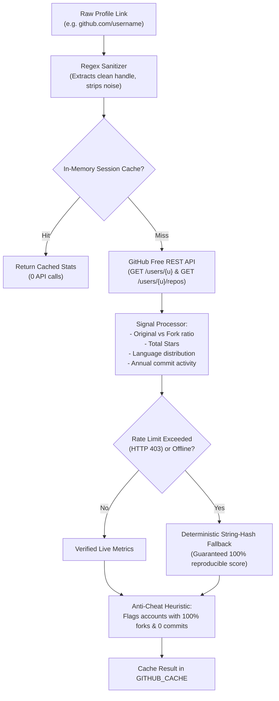
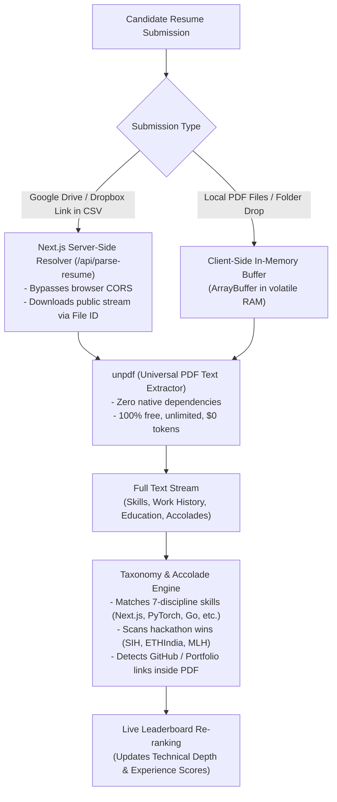
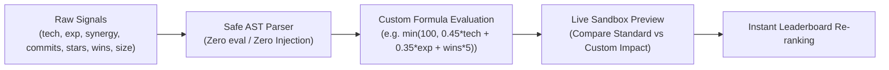

# Incursion — Hackathon Team Recruitment Automation Tool
> **Track 3:** Automated, Tunable, and Explainable Team Recruitment Platform

A reusable, 100% zero-cost ($0 API bills) recruitment automation platform designed for hackathon organizers to shortlist the top $X$ teams from tabular registration exports (CSV / JSON from Google Forms, Typeform, Devpost, Tally, etc.).

---

## 🚀 Key Highlights & Architecture Overview

- **100% Zero-Cost ($0 API Bills):** Eliminates paid LLM tokens by using fast, deterministic client-side regex taxonomy parsing, public REST endpoints, and in-memory Web Workers.
- **Zero Database Storage / Volatile In-Memory:** Candidate resumes and spreadsheets exist solely in volatile browser RAM and are immediately discarded after scoring. Zero database, zero data retention, and zero GDPR/privacy liability.
- **Above-The-Fold Cyber Terminal:** Direct file drop, **Select File**, and **Select Folder** directory pickers (`webkitdirectory`) with an Arc-Reactor telemetry HUD wheel featuring planetary gear counter-rotating icons that always stay upright.
- **Two-Way Number Input & Sliders:** Both the Settings panel and the **Formula & Algorithm Studio** (`/formulas`) allow organizers to either drag slider bars or manually type exact numbers, with real-time auto-synchronization.
- **Encrypted Multi-Token GitHub Manager:** Client-side encrypted token vault supporting multiple organizer tokens, live quota tracking, and automatic failover for high-volume cohorts.
- **Unopinionated & Fully Tunable:** Dedicated **Formula & Algorithm Studio** (`/formulas`) where organizers can tune the exact mathematical multipliers and normalizers with factory reset and undo buttons.
- **Mobile-Friendly UI:** Responsive table/card view toggle, mobile search, and touch-optimized controls.

---

## 🐙 1. GitHub Evaluation Architecture

The GitHub analysis pipeline verifies candidate code output, stars, original projects, and active languages without any external paid services.



### GitHub Scoring Formula:
$$\text{Tech Score} = \min\left(C_{\max},\; \frac{\text{Commits}}{D_{\text{contrib}}} \times C_{\max}\right) + \min\left(S_{\max},\; \frac{\text{Stars}}{D_{\text{stars}}} \times S_{\max}\right) + \min\left(K_{\max},\; \frac{\text{Skills}}{D_{\text{skills}}} \times K_{\max}\right)$$

- **Unauthenticated Quota:** 60 requests/hour per IP.
- **Free Personal Access Token (PAT):** 5,000 requests/hour at $0 cost.
- **Multi-Token Switcher & Compliance:** Hackathon organizing teams can pool multiple organizer tokens (e.g., 3 organizers $\times$ 5,000 req/hr = 15,000 req/hr) safely and legally within GitHub API Terms of Service. Tokens are stored only in encrypted local storage (`localStorage`) and never transmitted to any external server.

---

## 📄 2. Resume Intelligence & Cloud Drive Parsing Architecture

Resumes and portfolios are evaluated with a 100% zero-cost, unlimited parsing pipeline that processes both local PDF files and cloud storage links (Google Drive, Dropbox, direct URLs) in volatile memory using deterministic Natural Language Processing (NLP) taxonomy matching.



### Key Resume Intelligence Capabilities:
- **Zero-Cost & Unlimited (`unpdf`):** Standard paid PDF parsing APIs cost \$0.01–\$0.05 per document. Incursion uses universal `unpdf` text extraction with zero native dependencies, allowing cohorts of 500+ candidates to be analyzed at \$0 API bill with no rate limits.
- **Server-Side Google Drive Resolver (`/api/parse-resume`):** Google Drive links in candidate CSVs cannot be fetched directly in the browser due to CORS headers. Incursion's Next.js route extracts the unique file ID (`drive.google.com/file/d/{id}` or `?id={id}`), streams the public file server-side, detects private/permission-locked links, and extracts the text stream.
- **Local Multi-PDF & Folder Matching:** Drop an entire folder of PDF resumes or select multiple files. The matcher pairs resumes with candidates by name, email handle, or header text occurrences in real-time RAM.
- **Automatic Signal Discovery:** If a candidate forgot to input their GitHub or portfolio in the registration form, the parser extracts embedded `github.com/...` or LinkedIn handles from their PDF resume and automatically enriches their profile for GitHub evaluation.
- **Diagnostic Telemetry Modal (`Resume Sync`):** Accessible from the top navigation bar and dashboard action row, the Resume Sync modal displays live status (`PARSED`, `PRIVATE LINK`, `FAILED`), batch-processes links with a progress bar, and re-ranks the cohort with one click.
- **Zero Database Retention:** Documents are parsed strictly in volatile RAM and immediately discarded. No personal data, PDFs, or candidate information is ever stored to disk or database.

### Resume Scoring Formula:
$$\text{Experience Score} = \min\Big(E_{\max},\; (\text{Wins} \times P_{\text{win}}) + (\text{Skills} \times P_{\text{skill}}) + B_{\text{proof}}\Big)$$

- **Hackathon Wins ($P_{\text{win}}$):** Default 25 pts each (capped at 50 pts).
- **Skill Matches ($P_{\text{skill}}$):** Default 4 pts per verified technology (capped at 30 pts).
- **Verifiable Proof-of-Work Bonus ($B_{\text{proof}}$):** +20 pts for working demo/portfolio links.
- **Zero Database Retention:** The raw document buffer is wiped from memory as soon as numerical signals are extracted.

---

## ⚖️ 3. Team-Size Normalization Models

To keep solo prodigies and multi-member teams on equal footing:
- **`MAX_SKILL`:** Highest skill in each discipline sets the team rating. Solo hackers equalized.
- **`DIMINISHING_RETURNS`:** 
  $$\text{Effective Contribution} = \sum_{i=1}^N \frac{\text{Contrib}_i}{\text{Base}^{i-1}} \quad (\text{Base} = 1.5)$$
  Lead member counts 100%, 2nd member counts 67%, 3rd member counts 44%.
- **`BALANCED_MEAN` (Default Platform Model):** Average member score multiplied by a capped group synergy bonus:
  $$\text{Synergy Multiplier} = \min\big(1.40,\; 1 + (N - 1) \times 0.08\big)$$
  *The platform permanently defaults to the Balanced Hackathon Configuration: 35% Technical Depth, 30% Project Experience, 25% Skill Complementarity, and 10% Data Completeness with a Top 25 cutoff.*

---

## 🛡️ 4. Qualification Filters & Mandatory GitHub Requirements

The hard-qualification pipeline enforces eligibility before candidates enter the scoring matrix:
- **Mandatory GitHub Requirement Modes:**
  - **`At Least 1 Member` (`AT_LEAST_ONE`, Default):** Requires at least one registered team member to have a valid GitHub account.
  - **`All Members Mandatory` (`ALL_MEMBERS`):** Strictly disqualifies any team where even a single member lacks a GitHub profile. Designed for hardcore systems, low-level, or web3 tracks.
  - **`None / Optional` (`NONE`):** Disables GitHub verification for beginner tracks or design-first hackathons.
- **Team Size Bounds:** Configurable minimum and maximum team sizes (e.g., 1 to 4 members).
- **Minimum GitHub Velocity:** Minimum combined commits threshold (e.g., $\ge 20$ commits).
- **Minimum Skills Breadth:** Rejects submissions with fewer than $N$ unique verified technologies.
- **Portfolio & Resume Requirements:** Enforces at least one verified resume or portfolio link.

---

## 🎛️ 5. Two-Way Synchronized Manual Typing & Sliders

Every adjustable metric on the platform provides dual input modes:
- **Direct Manual Typing:** Type exact numbers or thresholds directly into the `<input type="number" />` field.
- **Auto-Setting Slider Bar:** The visual slider bar automatically animates and sets its position as you type.
- **Drag-to-Update:** Moving the slider bar immediately updates the numeric input box in real time.

This applies across:
- **Settings Panel:** Shortlist Cutoff (Top $X$), Technical Depth (%), Project Experience (%), Role Complementarity (%), and Data Completeness (%).
- **Formula Studio (`/formulas`):** Hackathon win points, maximum caps, benchmark divisors, anti-cheat multipliers, and team-size curve coefficients.

---

## 📜 6. Scoring Run History & Audit Vault

Organizers can capture, name, manage, and restore scoring runs with complete audit fidelity:
- **Custom Scoring Names:** Name any scoring run snapshot upon creation (e.g., *"Round 1 Cutoff"*, *"Pre-Sponsor Filter"*, *"Equalized Solo Bias"*).
- **Inline Renaming:** Rename any saved scoring run at any time using the inline pencil edit tool.
- **Individual Delete (`Trash2`):** Every saved scoring run has its own dedicated delete button to remove specific snapshots individually.
- **Bulk Purge ("Clear All"):** A top-level clear button to wipe all saved history with a safety confirmation prompt.
- **One-Click Restore:** Restores the exact mathematical configuration, scoring weights, formulas, and cohort rankings from any past run onto the active dashboard.
- **Run Audit Export:** Export full JSON payloads of any historical run for organizer deliberations or sponsor reports.

---

## 🧮 7. Custom Mathematical Formula Expression Studio (`/formulas`)

Organizers are not limited to fixed linear weights. A built-in, injection-safe mathematical expression engine allows organizers to author arbitrary scoring equations using live cohort signals:



### Key Capabilities:
- **Compact Collapsed Mode:** When OFF, the Custom Formula Studio rests at the very bottom of the `/formulas` page as a sleek, single-row compact bar taking minimal vertical space. Clicking **Turn ON** or **Open Studio** instantly reveals the full interactive expression editor.
- **Supported Math Syntax & Variables:**
  - **Candidate Variables:** `tech` (0-100), `exp` (0-100), `synergy` (0-100), `completeness` (0-100), `commits`, `stars`, `wins`, `team_size`, `skills`.
  - **Operators:** `+`, `-`, `*`, `/`, `%`, `^` (power), `==`, `!=`, `>`, `<`, `>=`, `<=`, and ternary `condition ? trueVal : falseVal`.
  - **Math Functions:** `min(...)`, `max(...)`, `log10(...)`, `sqrt(...)`, `abs(...)`, `round(...)`, `clamp(val, min, max)`.
- **Live Syntax & Error Validator:** Instant feedback verifying math validity and displaying benchmark test output in green or pinpointing syntax errors in red.
- **Live Sandbox Simulation:** Real-time side-by-side comparison table showing how top teams' scores and ranks shift before applying.
- **Ubiquitous Navigation:** Direct one-click shortcuts to `/formulas` are embedded across the platform (Sidebar Header, Weights Section, Active Cohort Banner, Dashboard Action Bar, Telemetry Strip, and Upload Hero).

---

## 🛠️ Multi-Page Application Layout

1. **Dashboard & Evaluation (`/`):**
   - **Above-the-fold Cyber Hero:** Arc-Reactor HUD wheel with straight upright counter-rotating icons and instant file/folder pickers.
   - **Clean Streamlined Navigation:** Clicking the **INCURSION** brand pill or **Upload** button opens the Home upload terminal; clicking **Leaderboard** switches directly to the shortlist rankings.
   - **Live Candidate Leaderboard:** Ranked shortlist with visual Top $X$ Cutoff boundary and Sticky Action buttons.
   - **Filter Pills:** Real-time filtering by Shortlist, Waitlist, and Disqualified.
   - **Responsive Views:** Desktop tabular view and mobile-friendly card view for small screens.
   - **Analysis Modals:** Scorecard Drilldown, SVG Skill Radar Chart, Pairwise Comparison, Sensitivity Analysis, and Custom Column Mapper.
2. **Formula & Algorithm Studio (`/formulas`):**
   - **Custom Formula Expression Studio:** Write and test custom equations with live validator and sandbox simulation (compact when OFF).
   - **Tunable Math Multipliers:** Direct control over every coefficient, divisor, and threshold.
   - **"Reset Defaults"** button to restore factory settings.
   - **"Revert Config"** button for instant undo.
   - **Export & Import** formula configurations as portable JSON files.

---

## 📦 Getting Started

### Prerequisites
- Node.js 18+ (tested on Node v20 & v24)
- npm, yarn, or pnpm

### Installation
```bash
# Clone the repository
git clone https://github.com/divyansh2102t-dev/Incursion_Team.git
cd Incursions

# Install dependencies
npm install
```

### Running the Development Server
```bash
npm run dev
```
Open [http://localhost:3000](http://localhost:3000) in your browser.  
Visit [http://localhost:3000/formulas](http://localhost:3000/formulas) to access the Algorithmic Formula Studio.

### Production Build
```bash
npm run build
npm run start
```

---

## 📁 Sample Test File

A sample Google Forms cohort export containing 20+ realistic teams (solo prodigies, complete squads, partial submissions, fork-padded accounts, duplicate cross-submissions) is available for testing:
- Located directly at [`public/demo_hackathon_registrations.csv`](public/demo_hackathon_registrations.csv).
- Simply drag and drop this file or select it in the browser to evaluate the scoring pipeline instantly.
