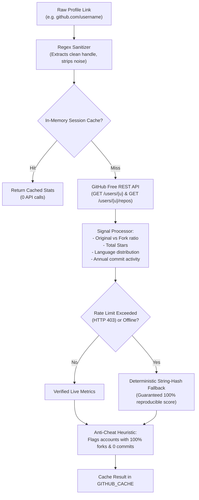
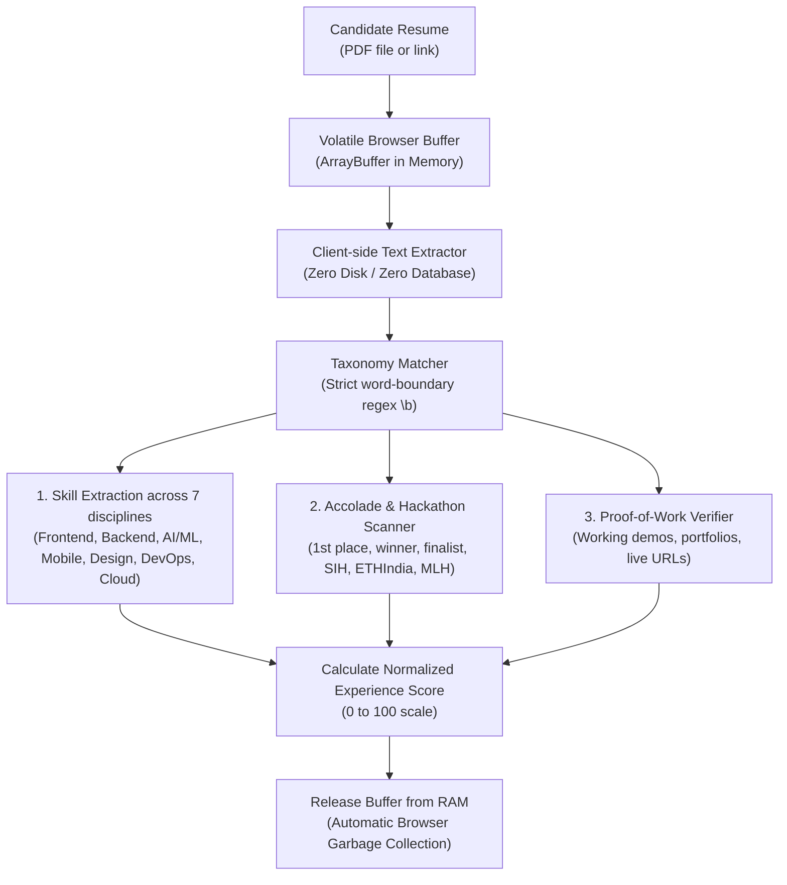

# Incursion — Hackathon Team Recruitment Automation Tool
> **Track 3:** Automated, Tunable, and Explainable Team Recruitment Platform

A reusable, 100% zero-cost ($0) recruitment automation tool designed for hackathon organizers to shortlist the top $X$ teams from tabular registration exports (CSV / JSON from Google Forms, Typeform, Devpost, etc.).

---

## 🚀 Key Highlights & Architecture Overview

- **100% Zero-Cost ($0 API Bills):** Eliminates paid LLM tokens by using fast, deterministic client-side regex taxonomy parsing, public REST endpoints, and in-memory Web Workers.
- **Zero Database Storage / Volatile In-Memory:** Candidate resumes and spreadsheets exist solely in volatile browser RAM and are immediately discarded. No database, zero data retention, and zero GDPR/privacy liability.
- **Unopinionated & Fully Tunable:** Includes both a **Weight Slider Dashboard** and a dedicated **Formula & Algorithm Studio** (`/formulas`) where organizers can tune the exact mathematical multipliers and normalizers.
- **Multi-Token GitHub API Manager:** Encrypted local storage supporting multiple organizer tokens, live quota tracking, and automatic fallback.
- **Mobile-Friendly UI:** Responsive table/card view toggle, mobile search, and touch-optimized controls.

---

## 🐙 1. GitHub Evaluation Architecture

The GitHub analysis pipeline verifies candidate code output, stars, original projects, and active languages without any external paid services.



### GitHub Scoring Formula:
$$\text{Tech Score} = \min\left(C_{\max},\; \frac{\text{Commits}}{D_{\text{contrib}}} \times C_{\max}\right) + \min\left(S_{\max},\; \frac{\text{Stars}}{D_{\text{stars}}} \times S_{\max}\right) + \min\left(K_{\max},\; \frac{\text{Skills}}{D_{\text{skills}}} \times K_{\max}\right)$$

- **Unauthenticated Quota:** 60 requests/hour per IP.
- **Free Personal Access Token (PAT):** 5,000 requests/hour at $0 cost.
- **Multi-Token Switcher:** Organizers can save multiple teammate tokens in encrypted local storage and switch between them when scanning thousands of applicants.

---

## 📄 2. Resume & Document Parsing Architecture

Resumes are evaluated purely in-memory using deterministic Natural Language Processing (NLP) taxonomy matching.



### Resume Scoring Formula:
$$\text{Experience Score} = \min\Big(E_{\max},\; (\text{Wins} \times P_{\text{win}}) + (\text{Skills} \times P_{\text{skill}}) + B_{\text{proof}}\Big)$$

- **Hackathon Wins ($P_{\text{win}}$):** Default 25 pts each (capped at 50 pts).
- **Skill Matches ($P_{\text{skill}}$):** Default 4 pts per verified technology (capped at 30 pts).
- **Verifiable Proof-of-Work Bonus ($B_{\text{proof}}$):** +20 pts for working demo/portfolio links.
- **Zero Database Retention:** The raw document is wiped from volatile memory as soon as numerical signals are extracted.

---

## ⚖️ 3. Team-Size Normalization Models

To keep solo participants and large teams on equal footing:
- **`MAX_SKILL`:** Highest skill in each discipline sets the team rating.
- **`DIMINISHING_RETURNS`:** 
  $$\text{Effective Contribution} = \sum_{i=1}^N \frac{\text{Contrib}_i}{\text{Base}^{i-1}} \quad (\text{Base} = 1.5)$$
- **`BALANCED_MEAN`:** Average member score multiplied by a capped group synergy bonus:
  $$\text{Synergy Multiplier} = \min\big(1.40,\; 1 + (N - 1) \times 0.08\big)$$

---

## 🛠️ Multi-Page Architecture

1. **Dashboard & Evaluation (`/`):**
   - Live ranked shortlist table with visual Top $X$ Cutoff line.
   - Mobile card view toggle for responsive viewing on smartphones.
   - Filter pills (Shortlist, Waitlist, Disqualified).
   - Real-time weight sliders and philosophy presets.
   - Modals: Team Scorecard Drilldown, SVG Skill Radar Chart, Pairwise Comparison, Sensitivity Analysis, and Column Mapper.
2. **Formula & Algorithm Studio (`/formulas`):**
   - Full control over every mathematical multiplier, divisor, and threshold.
   - Live mathematical equation displays.
   - **"Set to Default Formulas"** button to restore factory settings.
   - **"Revert to Previous Config"** button for instant undo.
   - Export & Import formula configurations as JSON.

---

## 📦 Getting Started

### Prerequisites
- Node.js 18+ (tested on Node v24)
- npm, yarn, or pnpm

### Installation
```bash
# Clone the repository
git clone https://github.com/divyansh2102t-dev/Incursion_Team.git
cd Incursions

# Install dependencies
npm install
```

### Running the Development Server
```bash
npm run dev
```
Open [http://localhost:3000](http://localhost:3000) in your browser.
Visit [http://localhost:3000/formulas](http://localhost:3000/formulas) to access the Algorithmic Formula Studio.

---

## 📁 Sample Test File

A sample Google Forms export with 20+ realistic teams (solo prodigies, complete squads, partial submissions, fork-padded accounts, duplicate cross-submissions) is available for testing:
- Download directly via the app by clicking **"Download Demo CSV"** or access [`public/demo_hackathon_registrations.csv`](public/demo_hackathon_registrations.csv).
